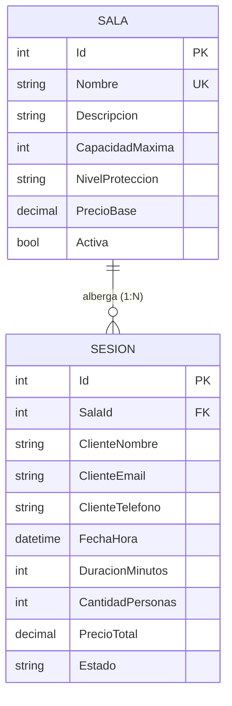

# Laboratorio 12: Web API REST con ASP.NET Core y Entity Framework Core
**Curso:** Desarrollo de Aplicaciones Empresariales Avanzadas  
**Tema:** Rage Room (Salas de Desahogo y Destrucción)  
**Tecnologías:** .NET 10, ASP.NET Core Web API, Entity Framework Core 10, SQL Server, OpenAPI / Swagger  

---

## 1. Justificación y Explicación del Tema

### ¿Qué problema resuelve?
En la vida moderna, los altos niveles de estrés laboral, la ansiedad y la sobrecarga cotidiana exigen válvulas de escape efectivas, seguras y controladas. Un **Rage Room** ("Sala de Ira") permite a las personas desahogar tensión física y emocional destruyendo objetos de forma terapéutica y segura (vajilla, electrodomésticos, botellas de vidrio, monitores e impresoras), equipadas con la debida indumentaria de seguridad.

La **Web API REST de Rage Room** automatiza:
- La administración y configuración de las diferentes salas disponibles según su aforo y nivel de seguridad.
- El agendamiento y reserva de sesiones horarias por parte de los clientes.
- El control de aforo por sala para evitar sobrepasar límites de seguridad.
- La prevención de conflictos y solapamientos de horarios en un mismo espacio físico.
- El seguimiento del ciclo de vida de la sesión (`Pendiente` -> `Confirmada` -> `Completada` o `Cancelada`).

---

## 2. Modelo de Entidades y Relación 1:N

El dominio cuenta con dos entidades vinculadas mediante una relación **1 a N** con clave foránea y propiedad de navegación:



### Entidad Padre: `Sala`
- `Id` (int, Clave primaria autoincremental).
- `Nombre` (string, `[Required]`, `[StringLength(50)]`, índice único).
- `Descripcion` (string, `[StringLength(250)]`).
- `CapacidadMaxima` (int, `[Required]`, `[Range(1, 10)]`).
- `NivelProteccion` (string, `[Required]`, `[StringLength(20)]`, ej: 'Básico', 'Intermedio', 'Extremo').
- `PrecioBase` (decimal, `[Required]`, `[Range(0, 10000)]`).
- `Activa` (bool, default `true`).
- **Navegación:** `[JsonIgnore] public virtual ICollection<Sesion> Sesiones { get; set; }` para evitar ciclos de serialización JSON sin usar DTOs.

### Entidad Hija: `Sesion`
- `Id` (int, Clave primaria autoincremental).
- `SalaId` (int, Clave foránea hacia `Salas`).
- `ClienteNombre` (string, `[Required]`, `[StringLength(100)]`).
- `ClienteEmail` (string, `[Required]`, `[EmailAddress]`).
- `ClienteTelefono` (string, `[Phone]`, opcional).
- `FechaHora` (DateTime, `[Required]`).
- `DuracionMinutos` (int, `[Required]`, `[Range(15, 120)]`, valores comunes: 15, 30, 45, 60).
- `CantidadPersonas` (int, `[Required]`, `[Range(1, 10)]`).
- `PrecioTotal` (decimal, `[Required]`, `[Range(0, 50000)]`).
- `Estado` (string, `[Required]`, 'Pendiente', 'Confirmada', 'Completada', 'Cancelada').
- **Navegación:** `public virtual Sala? Sala { get; set; }` configurada como **anulable (`Sala?`)**, permitiendo que en peticiones `POST` y `PUT` solo sea necesario enviar la clave foránea `SalaId`.

---

## 3. Códigos de Respuesta HTTP y Reglas de Negocio

La API maneja rigurosamente los 6 códigos `ActionResult` requeridos:

| Código HTTP | Nombre | Escenarios de Aplicación |
| :---: | :--- | :--- |
| **`200 OK`** | Ok | Consultas exitosas en `GET` (listados generales, listados con filtros, consulta por ID y ruta anidada). |
| **`201 Created`** | CreatedAtAction | Registro exitoso de recursos (`POST /api/salas` y `POST /api/sesiones`), incluyendo la cabecera `Location`. |
| **`204 NoContent`** | NoContent | Actualización exitosa (`PUT`) o eliminación exitosa (`DELETE`). |
| **`400 BadRequest`** | BadRequest / ValidationProblem | Incumplimiento de Data Annotations, ID de ruta no coincide con ID del cuerpo, clave foránea inexistente o violación de aforo/sala inactiva. |
| **`404 NotFound`** | NotFound | El identificador solicitado no existe en la base de datos. |
| **`409 Conflict`** | Conflict | Incumplimiento de reglas de negocio críticas del dominio. |

### Reglas de Negocio implementadas con `409 Conflict`:
1. **Regla de Nombre Único (Salas):** No se permite registrar ni actualizar una sala con un nombre que ya exista en el catálogo.
2. **Regla de Eliminación de Sala con Dependencias:** No se puede eliminar una sala que tenga sesiones agendadas o históricas asociadas.
3. **Regla de Solapamiento / Cruce de Horarios (Sesiones):** No se permite reservar una sesión en una sala si el intervalo de tiempo (`FechaHora` hasta `FechaHora + DuracionMinutos`) coincide con otra sesión activa en esa misma sala.
4. **Regla de Inmutabilidad de Sesiones Completadas:** No se puede editar ni borrar una sesión en estado `Completada` por temas de auditoría contable.

---

## 4. Endpoints de la API (11 Endpoints)

### `SalasController` (`/api/salas`)
- `GET /api/salas`: Listado de salas con filtros opcionales en query string:
  - `?buscar=furia` (búsqueda en nombre y descripción)
  - `?activa=true`
  - `?capacidadMinima=3`
- `GET /api/salas/{id}`: Detalle de sala por ID.
- `GET /api/salas/{id}/sesiones`: **Ruta anidada requerida**. Obtiene todas las sesiones de una sala.
- `POST /api/salas`: Crea una nueva sala.
- `PUT /api/salas/{id}`: Actualiza los datos de una sala.
- `DELETE /api/salas/{id}`: Elimina una sala (valida dependencias con 409).

### `SesionesController` (`/api/sesiones`)
- `GET /api/sesiones`: Listado de sesiones con sala relacionada (LINQ `Include`), con filtros:
  - `?estado=Confirmada`
  - `?salaId=1`
  - `?clienteEmail=carlos`
  - `?fecha=2026-11-05`
- `GET /api/sesiones/{id}`: Detalle de sesión por ID con sala incluida.
- `POST /api/sesiones`: Registra una nueva sesión (valida FK, aforo máximo y cruce horario).
- `PUT /api/sesiones/{id}`: Modifica una sesión.
- `DELETE /api/sesiones/{id}`: Elimina una sesión pendiente o cancelada.

---

## 5. Instrucciones de Ejecución Local

1. **Crear la base de datos SQL Server:**
   Abrir SQL Server Management Studio (SSMS) o Azure Data Studio y ejecutar el script `RageRoomDb.sql`.

2. **Revisar la cadena de conexión:**
   En `RageRoomApi/appsettings.json`, verificar que apunte a tu servidor local de SQL Server:
   ```json
   "ConnectionStrings": {
     "DefaultConnection": "Server=(localdb)\\mssqllocaldb;Database=RageRoomDb;Trusted_Connection=True;MultipleActiveResultSets=true;TrustServerCertificate=True"
   }
   ```

3. **Ejecutar la API:**
   ```bash
   cd RageRoomApi
   dotnet run
   ```

4. **Acceder a Swagger:**
   Abrir en el navegador:
   - `http://localhost:5000/swagger` o la URL mostrada en consola.

5. **Pruebas de Endpoints:**
   Abrir el archivo `RageRoomApi/RageRoomApi.http` en Visual Studio o VS Code (con la extensión REST Client) para ejecutar cada una de las pruebas de los 6 códigos de estado.

---

## 6. Guía de Publicación Gratuita en la Nube

Para cumplir con el requisito de publicación de API y Base de Datos en la nube sin costo:

### Plataforma Recomendada: MonsterASP.net
MonsterASP.net ofrece hosting gratuito para ASP.NET Core junto con una base de datos Microsoft SQL Server gratuita.

1. Registrarse gratis en [MonsterASP.net](https://www.monsterasp.net/).
2. Crear un nuevo sitio web y una base de datos **MSSQL**.
3. Tomar nota de los datos de conexión (Servidor, Base de Datos, Usuario, Contraseña).
4. Conectarse a la base de datos de MonsterASP desde SSMS y ejecutar el script `RageRoomDb.sql`.
5. Compilar la aplicación en modo Release:
   ```bash
   dotnet publish -c Release -o ./publish
   ```
6. Comprimir la carpeta `publish` en formato `.zip` y subirla desde el File Manager o vía WebDeploy / FTP en el panel de MonsterASP.net.
7. En el panel de control de MonsterASP, ir a **Configuration / Environment Variables** y agregar:
   - **Clave:** `ConnectionStrings__DefaultConnection`
   - **Valor:** `Server=...;Database=...;User Id=...;Password=...;TrustServerCertificate=True;`
8. Probar la API en la nube abriendo:
   `https://tu-sitio.monsterasp.net/swagger`
9. En `RageRoomApi.http`, cambiar `@baseUrl = https://tu-sitio.monsterasp.net` y realizar las pruebas en producción para las capturas del informe.

